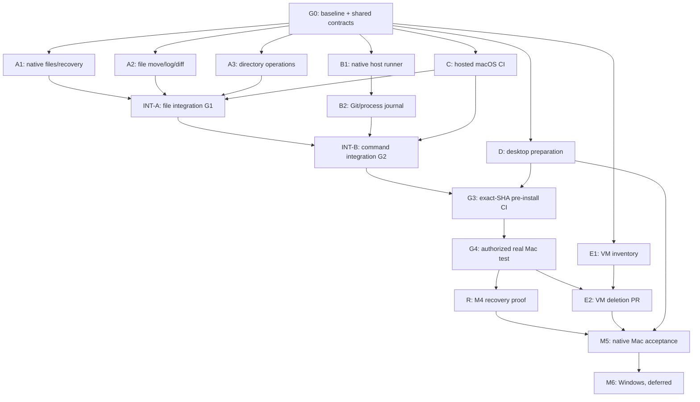

# Milestones — Native Mac V3 Parallel Task DAG (2026-11-05)

## GOAL

Implement all approved `docs/CRITERIA.md` capabilities on **native macOS** through the online GSA connector, requiring GitHub-hosted macOS pre-install test PASS and real Mac installed-plugin proof before M5. Freeze then fully retire the old product VM; Windows M6 only after Mac M5 acceptance. Milestone IDs M0–M6 are preserved. Task execution is parallel when contracts/files are independent; integration/acceptance gates are sequential. No new VM, CI/DAG engine, local AI agent or per-operation approval gate.

**Canonical**: [Implementation Plan V3](IMPLEMENTATION_PLAN.md), [Technical Proposal V3](TECHNICAL_PROPOSAL.md), [Criteria](CRITERIA.md). Older proposal/history is in `docs/archive/TECHNICAL-PROPOSAL-LEGACY-PRE-20261105.md`; it cannot override current tasks. No task is marked completed by source-only or historical VM evidence.

### Execution notation and branch rules

- **S**: must happen sequentially before dependent source modification/integration.
- **P**: can be developed simultaneously on distinct branches with explicit file ownership after G0.
- **I**: serial integration/acceptance gate, with exact-SHA GitHub-hosted macOS CI.
- One integration agent owns `src/mcp/{server,catalog,runtime-bootstrap,write-dispatch,batch-dispatch}.ts` and serially applies cross-track changes.
- Parallel branches start at one verified baseline; no product code changes until Plan, Milestones and Technical Proposal review is complete and Human approves implementation.
- Existing `codex/mac-completion` local dirty/unpushed content must be inspected/retained before branches integrate; no reset, force-push or undisclosed replacement.
- Every task outputs exact branch/base/HEAD, owner and changed files, test command/result/skips and evidence; task PASS is not automatic milestone acceptance.

## M0/M1 — Shared baseline and interface decisions

### GOAL

Preserve current Mac work, lock minimal API contracts, freeze VM and make multi-agent assignments safe.

| Task ID | Work | Dependencies | Mode | Deliverable / exit |
|---|---|---|---|---|
| P0-01 | Inspect source/branch/dirty Mac work, active plugin, exact approved Criteria | none | **S first** | current baseline/source-vs-host evidence inventory; no user data loss |
| P0-02 | Reconcile `NativeScopedFiles`/file journal, `SandboxedProcessRequest`/native command adapter, Controller/Lease and shared MCP owners | P0-01 | **S** | small interface/caller map frozen for branch authors |
| P0-03 / E1 | Freeze VM; map runtime imports, guest code, media, legacy CI/test and removable edges | P0-01 | **P with P0-02** | deletion map and preserved-media boundaries |
| P0-04 | Reconcile GSA Job M2→M3 linear history with split source task DAG; review current exact revision | P0-01, new V3 docs | **S for G0** | durable Job/Reviewer exact SHA and no competing source of truth |
| G0 | Confirm frozen interface, branch ownership and no overlapping edits | P0-01/02/04 | **I** | implementation may be offered for Human approval; no source work yet |

## M2 — Mac multi-root file operations

### GOAL

Working roots support complete scoped file operations; references support list/search/read and copy-out only; mutations never silently overwrite user work.

| Task ID | Work | Dependencies | Mode | Acceptance |
|---|---|---|---|---|
| A1 | Repair prior bounded stopped-owner fixture; complete checked recovery/installer path | G0 | **P with B/C/D/E** | owned child physically stopped before fixture cleanup; journal/capture/generation preserved; UNKNOWN/no replay |
| A2 | File move, operation-log reader, non-Git diff with captured baseline | G0, A1 existing transaction interface | **P except shared file modifications S** | CAS/partial outcomes; A↔B file move; workspace/reference denials; no duplicate side effect |
| A3 | Directory copy, reference copy-out, same-workspace/volume atomic rename (D2) | G0 | **P with A1 on non-overlapping files** | no overwrite, rejected cross-root/volume rename, native positive/negative |
| INT-A | Serially integrate reviewed A1/A2/A3 into MCP file surface | A1,A2,A3,C-A | **I** | GitHub macOS **G1** exact SHA source + native-safe C-A PASS; unsafe capability still blocked |
| M2 accept | Installed/plugin file operations proven | INT-A and later G4 | **I after G4** | full §3/§4/§7 actual Mac file API evidence; M2 not auto-accepted by G1 |

## M3 — Native Mac command, Git, tests and process evidence

### GOAL

Run actual macOS user-account scripts/Git on a selected working root, with truthful result/log/owned stop and unconfined-command warning.

| Task ID | Work | Dependencies | Mode | Acceptance |
|---|---|---|---|---|
| B1 | Native host adapter behind `VerifiedNativeSandbox`-compatible seam, no VM | G0 | **P with A/C/D/E** | macOS native child spawn and scoped cwd admission; host identity |
| B2 | Optional descendant cwd, network/secret defaults, physically owned process-group cancellation | B1 interface | **S within B, P with A** | `cwd_relative` verified against root; neighbor process untouched; uncertainty = UNKNOWN |
| B3 | Existing process journal/results/log cursors, local Git, non-Git build/test script | B1 and B2 semantics | **S within B, P with A** | stdout/stderr/exit, result/artifact provenance, dirty Git preserved and retry safety |
| B4 | One MCP integrator replaces VM runtime/composition and Git blanket denial, fixes catalog/diagnostic truth | INT-A, B1/B2/B3 reviewed | **I** | no `linux-arm64-vm` claim for native calls; `command_confinement:none`, `state_integrity_vs_commands:not_protected` |
| INT-B | Exact SHA hosted macOS commands/Git tests | B4 + C-B | **I (G2)** | C0+C-A+C-B actual Mac hosted tests PASS; no VM fallback |
| M3 accept | Selected-plugin installed host command/CI/script capabilities | INT-B + later G4 | **I after G4** | actual user's Mac evidence and per-run output/stop/status |

**Source may start B1 while M2 A* is still in progress**. Only B4 MCP integration and final M3 acceptance depend on verified M2 grant surface. This removes the old false M2→M3 *source-coding* dependency while retaining necessary acceptance dependency.

## M4 — True process/file continuity

### GOAL

Report crash/restart/reboot/wake accurately without replay, corrupting history or killing unrelated processes.

| Task ID | Work | Dependencies | Mode | Acceptance |
|---|---|---|---|---|
| R1 | Implement owner fencing, durable process/file UNKNOWN/readback and source cancellation cases using existing journal | B2/B3 stable contract | **P with late A/B/C** in disjoint files | tests for false success, repeated mutation, stale owner and unrelated process |
| R2 | Native reconciliation and physical-stop proof on installed Mac | G4 and R1 | **I** | actual crash/service restart/reboot/wake outcomes, no duplicate mutation, honest UNKNOWN |
| M4 accept | End-to-end recovery | R2 | **I** | documented M4 evidence with exact installed artifact |

## M5 — Final Mac acceptance and VM retirement

### GOAL

Ship native Mac user journey with no product VM runtime dependency, complete selected-plugin and desktop lifecycle evidence.

| Task ID | Work | Dependencies | Mode | Acceptance |
|---|---|---|---|---|
| C0 | GitHub macOS base source/build and explicit non-VM suites | P0-01 | **P with A/B** | macos-latest Node22 exact SHA, no stale/VM test mislabeling |
| C-A | M2 signed broker/disposable file fixtures and required script wiring | A task contracts, C0 | **P with B/D** | mandatory C-A tests fail if absent/skipped at G1 |
| C-B | M3 actual macOS command/Git/cancel test fixtures and required script wiring | B task contracts, C0 | **P with A/D** | mandatory C-B tests fail if absent/skipped at G2 |
| D1 | Existing Mac Dock/login setup, ignored .env, Pause/Resume/Quit lifecycle and package tests | G0 | **P with A/B/C** | hosted safe simulation/pass; no local installation |
| G3 | Full exact-candidate pre-install macOS CI, package/evidence review | G1,G2,D1 source tests | **I** | C0+C-A+C-B+package required PASS (no missing mandatory suite); installer SHA/identity pinned |
| G4 | Controlled real Mac install and selected-plugin smoke/functional tests | G3 + explicit separate installation authorization | **I** | native host files/Git/build/process/log on disposable roots; preserve neighbors |
| E2 | Remove VM-only runtime/guest/installer/tests/CI hooks in separate reversible PR | E1 + G4 native replacement proof | **I** | zero shipped product VM dependencies, C-VM macOS CI green, history and user media preserved |
| D2 | Real Mac desktop/login/tunnel/lifecycle acceptance | G4,D1 | **I** | Dock background setup, pause/resume/quit, no other apps affected |
| M5 accept | All Mac Criteria and package accepted | M2/M3 accept, M4 accept, E2, D2 | **I** | selected Mac full journey/independent projects, no required gap, no VM dependency |

**Rollback:** E2 deletion branch/PR remains separate. If CI red, do not merge it; if integrated and broken, roll back only E2 source changes while preserving native Mac artifacts. No automatic reactivation of VM. Changing installed connector is always separately reviewed/authorized and retains previous generation/data; never delete original VM media.

## M6 — Windows deferred

### GOAL

After Mac M5 is genuinely accepted, implement same API and user journey on Windows using appropriate native file/process/security mechanisms.

| Task ID | Dependencies | Mode | Exit |
|---|---|---|---|
| M6-01 Windows native design/implementation | **M5 accepted** | **S, deferred** | Windows API/native runtime proof on its own host |
| M6-02 Windows installed-plugin acceptance | M6-01 | **I** | real Windows evidence; no simultaneous multi-machine matrix |

## Review and evidence policy

Reviewer examines this DAG, Criteria coverage, all task-to-code ownership, no Task dependency cycle, exact source host/caller mapping in Technical V3, pre-install CI test existence/mandatory logic, honest unconfined execution, VM deletion rollback, dirty-tree preservation, and role-isolated GSA planning Job revision. Historical PR/CI results do not make a milestone complete.

**Current state:** documentation prepared for Reviewer; M2 IN PROGRESS; M3/M4/M5 NOT ACCEPTED; M6 DEFERRED; VM frozen for future retirement, **not yet deleted**; no product source changes or user Mac installation in this planning review.

## Canonical dependency graph and five parallel assignments

**GSA task IDs are descriptive cross-references to the V3 planning Job, not authorization to execute.** This DAG overrides sequential list order from historic Project Plan jobs. Each arrow below is a true prerequisite; unrelated nodes may run concurrently. Any generated `topology.stage` or `next` field is only a display order and MUST NOT add dependency edges absent from `depends_on`/`planning_topology`.

The diagrams are explanatory; the authoritative machine-readable dependency list is below.

| Task | GSA Job node | True prerequisites | Parallel assignment / coding owner | Review and readiness |
|---|---|---|---|---|
| G0 | `...000001` | P0 baseline, current reviewed Criteria | Integrator, **sequential first** | froze interfaces, shared MCP owner and dirty-tree custody |
| A1 | `...000002` | G0 | A — Mac signed file delivery | physical owned fixture cleanup before rerun, journal survives |
| A2 | `...000003` | G0 + A1 *interface* (not completed A1 feature) | A — file operations subbranch (disjoint files) | CAS, move A↔B, non-Git diff and partial UNKNOWN |
| A3 | `...000004` | G0 | A — directory subbranch | same-root atomic no-overwrite, reference copy-out |
| B1 | `...000005` | G0 | B — native commands | real Darwin, no VM fallback or OS confinement claim |
| B2 | `...000006` | B1 interface | B — process/Git subbranch | validated subcwd, logs, clean stop and neighbor untouched |
| C | `...000007` | G0 | C — GitHub-hosted Mac CI | mandatory non-VM suites and missing-tests-fail contract |
| D | `...000008` | G0 | D — desktop lifecycle | no actual login/system mutation during source prep |
| E1 | `...000009` | G0 (can inventory early after P0-01) | E — VM mapping | classify imports; do not delete existing user media |
| INT-A | `...000010` | A1+A2+A3+C | Integration owner only | G1 hosted C-A PASS |
| INT-B | `...000011` | INT-A+B2+C | Integration owner only | G2 hosted C-B PASS, Git enabled only with actual backend |
| G3 | `...000012` | INT-B+D | Integration owner and C | exact install candidate macOS CI C0/C-A/C-B/package PASS |
| G4 | `...000013` | G3 + separate installer authorization | Human attended Mac-local acceptance | installed selected plugin, disposable roots, no neighbor damage |
| R / M4 | `...000014` | B2 contract; *physical evidence* after G4 | Recovery owner; source may prepare in parallel | restart/reboot/wake/UNKNOWN/no replay |
| E2 | `...000015` | E1 + G4 native replacement proof | E — isolated VM deletion PR | zero runtime VM imports, C-VM hosted PASS, reversible rollback |
| M5 | `...000016` | G4+R+E2+D | Integration and acceptance owner | full Mac user journey and independent projects |
| M6 | `...000017` | **M5 accepted** | Windows owner, not assignable in Mac phase | Windows-only native parity and independently observed proof |

**Dispatch waves:** Wave 0 = G0 review and ownership freeze; Wave 1 = simultaneous A/B/C/D/E1 source research and coding *after later Human implementation authorization*; Wave 2 = serial reviewed INT-A → INT-B with exact-SHA hosted CI; Wave 3 = G3 → G4 → M4/E2 → M5; Wave 4 = Windows M6 only after Mac acceptance. `R` source preparation may overlap Wave 1/2 once B2 interface is stable; only actual-host R acceptance waits G4.

**Parallelism is bounded by file ownership.** A1/A2/A3 are distinct delivery units, not three uncoordinated writers to `macos-file-recovery.ts` or shared installer. B1/B2 are sequential around the process interface. All MCP `server/catalog/runtime-bootstrap/write-dispatch/batch-dispatch` code remains exclusive to the integrator. GSA task IDs ending `000001`–`000017` are registry identifiers; they are not a mandate to recreate a separate local orchestrator.

**Hosted macOS test distinction:** Existing PR #4 CI PASS ran a limited source/native-safe baseline, not G1/G2/G3. G1 must require the A suite, G2 the B suite, G3 the full A+B+packaging suite. Missing mandatory fixture or skipped mandatory case is blocked/fail, never a source-success substitute for the installed Mac proof. M5 is never completed from hosted CI alone.

